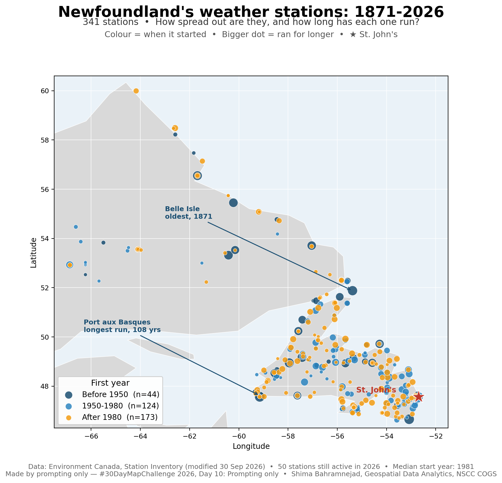

# Newfoundland Weather Stations, 1871-2026

## What this is
A map of 341 weather stations in Newfoundland, made for Day 10 of the #30DayMapChallenge 2026. Day 10 theme: "Prompting only" — make a map from start to finish by prompting an AI.

Question: How is Newfoundland's weather station network spread out, and how long has each station run?



## What the map shows, in plain words
- Colour = when a station started: before 1950 (44 stations), 1950-1980 (124), after 1980 (173).
- Bigger dot = the station ran for longer. Median run: 16 years.
- Most stations are on the island, near the coasts. Labrador's interior is almost empty.
- Oldest: Belle Isle, 1871. Longest run: Port aux Basques, 1909-2017, 108 years. 50 stations still active in 2026. Median start year: 1981.

## Files in this folder
- `nl-weather-stations-map.png` — the finished map
- `make_map.py` — the Python code that made the map
- `station_inventory_en.csv` — the data file, downloaded by code
- `canada.geo.json` — Canada outline used for the grey land

## How to run it
Python 3, with pandas and matplotlib installed. In VS Code, open this folder, open a terminal, run:

```
pip install pandas matplotlib
python make_map.py
```

The new map is saved as `day10_nl_weather_stations.png` in the same folder.

## Data
Environment Canada, Station Inventory, modified 30 Sep 2026. Public download, no key needed. 8,637 stations in Canada, 341 in Newfoundland after filtering by Province = NEWFOUNDLAND.

## Related work
This is the same dataset as my R project: "How is Newfoundland's weather station network spread out, and how long has each station run?"
