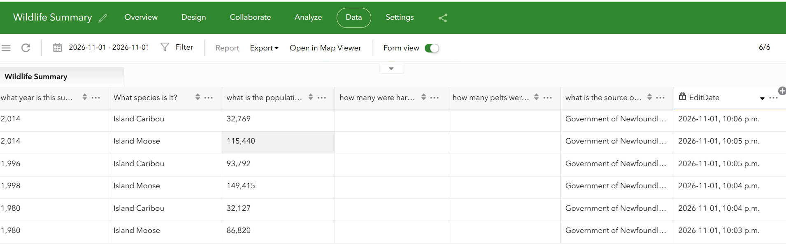
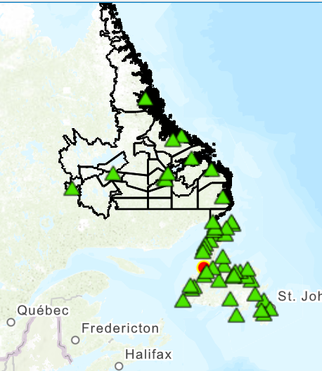
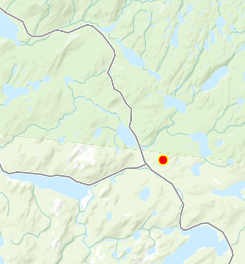
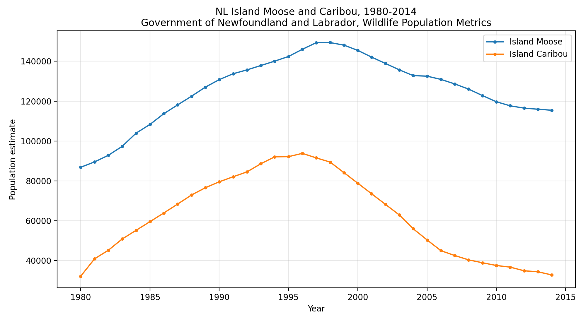

# Wildlife Analysis — Survey123 summary data, mapped with government management areas

## What this is
A small, honest analysis, built Nov 1, 2026, from two Survey123 surveys I designed, plus government open data. It uses A for B: first a summary form (A), then a map and analysis (B) that uses that summary data.

Honest status: **practice analysis, not field project experience.**
The Wildlife Check point is a demo only, at a public park location, not a real sighting. The summary records are government yearly totals, entered by hand, clearly labelled government summary, not field collection.

## Part A — Wildlife Summary survey (the summary form)
Survey123 Connect, Standard Template, published Nov 1, 2026, ~22:00 NST.
Survey ID in the Survey123 website: 380e6da12c7b4f689d5c0a131c22b0df. Owner GDAAShimaB_AGOL, survey private.

6 questions:
1. summary_year, integer — "what year is this summary for?" — the name "year" was blocked as a special word in Survey123, so summary_year was used.
2. species, select_one species — "What species is it?"
3. pop_estimate, integer — "what is the population estimate?"
4. harvest, integer — "how many were harvested?"
5. pelts_sold, integer — "how many pelts were sold?"
6. data_source, text — "what is the source of this number?" — the name "source" was blocked as a special word, so data_source was used.

Species choices, 8, matching the government file, so Island and George River caribou are kept separate:
Island Moose, Island Caribou, George River Caribou, Island Black Bear, Island Coyote, Labrador Wolf, Lynx, Snowshoe Hare.

Summary records entered via the web form, verified in the Data tab, 6/6, Nov 1, 2026:
- 1980, Island Moose, 86,820
- 1980, Island Caribou, 32,127
- 1998, Island Moose, 149,415
- 1996, Island Caribou, 93,792
- 2014, Island Moose, 115,440
- 2014, Island Caribou, 32,769

Harvest and pelts sold are blank for moose and caribou, because those numbers are not in the government file for those species. Source for all 6 records: Government of Newfoundland and Labrador, Wildlife Population Metrics.

Image: `wildlife-summary-data.png` — Wildlife Summary, Data tab, 6/6, with the table above. The source column is cut off in the screenshot; the full source is written here.

## Part B — Map and analysis
Map Viewer, ArcGIS Online, Nov 1, 2026, saved as "Wildlife Analysis Map", Owner GDAAShimaB_AGOL.

Sharing note: the live map is private, Owner only. In the Share dialog, Organization and Everyone (public) were greyed out, with the note "Some share level options are limited by your sharing privileges." So outside sponsors cannot open the live map without NSCC sign-in. The screenshots in this folder are the public proof, not a live map link.

Layers on the map:
- Wildlife Check, my own Survey123 point, red point: Moose, Animal seen, 1, demo record, Gros Morne National Park area, near Rocky Harbour, Lat 49.396952, Lon -57.595005, EditDate 2026-11-01, 9:04 p.m. — see the wildlife-check folder for the Data tab proof.
- Moose Management Areas and Moose Jawbone Drop off Locations, government Feature layer, owner sarahhynes@gov.nl.ca_GNL, data updated Dec 18, 2025, https://www.arcgis.com/home/item.html?id=ef32aabe2db545a281380e6030257606 — 54 Moose Management Areas and 63 Jawbone Drop off Locations across Newfoundland and Labrador. Black outline = management area, green triangle = jawbone drop-off point, NOT sightings, NOT population.
- Note on the map route: "Open in Map Viewer" from the Wildlife Check Data tab failed with "layer view requires a layer with query capability" and an empty map. The point layer was added again from My Content, plain Wildlife Check feature layer, not the _form item, and that worked.

Image: `wildlife-analysis-map.png` — province view, black polygons, green triangles, red point on the west coast.

Image: `wildlife-analysis-point-zoom.png` — zoomed view of the red point, with polygon boundary lines, roads, and lakes nearby.

## Analysis findings, in plain words
1. **Where is the demo point?** On the west coast, in the Gros Morne area. At the zoomed view, no management area polygon popup appeared for the point area, and at province view no black polygon surrounds the red point. The honest finding is: the demo point does **not** sit inside a visible management area polygon in this layer. It may be in park land, which is not a hunting management area. No management area number is claimed for this point.
   - Do NOT use MMA 086, St. Augustin, Mainland Labrador section, for this point. That popup was a Labrador polygon clicked by mistake at province zoom, not the Gros Morne point.
2. **Nearest jawbone drop-off found:** Deer Lake Ultramar, District 16, Zone 21 U, Easting 468,722.64, Northing 5,448,220.07. That is a drop-off location, not a sighting, and not the demo point's management area.
3. **What do the summary records show?** Moose and caribou both rose, then fell, over 1980–2014:
   - Island Moose: 86,820 in 1980, peak 149,415 in 1998, 115,440 in 2014.
   - Island Caribou: 32,127 in 1980, peak 93,792 in 1996, 32,769 in 2014, back near the 1980 level.
   - Note in the source CSV: "Moose population estimate includes National Parks".
4. **What does this mean together?** The demo point shows how a field point would be mapped, the summary records show the long-term island totals, and the government polygons show where hunting management areas are. The three do not line up into one number, because the point is a demo in a park area, the totals are whole-island yearly numbers with no location, and the polygons are hunting zones. That gap is part of the finding, not hidden.

Chart: `moose-caribou-1980-2014.png` — Island Moose and Island Caribou population estimates, 1980–2014, from the government CSV, same chart as in the wildlife-check folder.

## Sources, clearly labelled
- My own Survey123 work: Wildlife Check (point, demo), Wildlife Summary (6 summary records, table above).
- Government work, not mine: Wildlife Population Metrics CSV/XLS, Government of Newfoundland and Labrador, Open Government Portal https://open.canada.ca/data/en/dataset/b5eec541-90d2-f93b-f8ee-54ea335c9b5e, years 1980–2014, yearly totals, no locations — no X/Y coordinates were added to that file.
- Government work, not mine: Moose Management Areas and Moose Jawbone Drop off Locations layer, see link above.

## Files in this folder
- `README.md` — this summary and analysis
- `wildlife-analysis-map.png` — province map, point plus polygons and triangles
- `wildlife-analysis-point-zoom.png` — zoomed demo point
- `wildlife-summary-data.png` — Wildlife Summary Data tab, 6 records
- `moose-caribou-1980-2014.png` — chart from the government CSV
- Wildlife Summary XLSForm (.xlsx) — to be added from the exact Connect file, when uploaded. It is not recreated here from memory.
- Wildlife Check XLSForm (.xlsx) — to be added from the exact Connect file, when uploaded, in the wildlife-check folder. It is not recreated here from memory.

## Safety note
For real field use: keep a safe distance, never approach moose or bears, and record from a public place, not from home.
