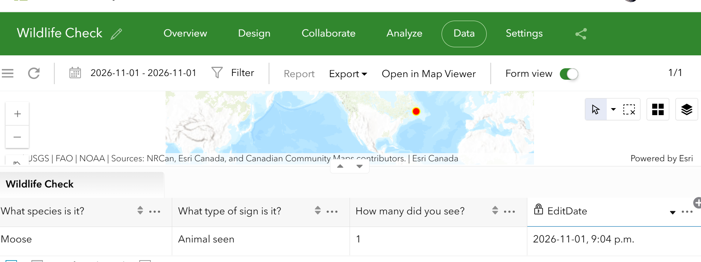

# Wildlife Check — Survey123 survey, designed and tested

## What this is
A Survey123 Connect survey I designed and published on Nov 1, 2026, to record wildlife signs in Newfoundland and Labrador. The species list comes straight from Government of Newfoundland and Labrador open data, Wildlife Population Metrics (1980–2014).

Honest status: **survey designed and tested. Field collection to come later.**
No real field records are shown here. One demo record was sent via the web form (see Demo record below), clearly labelled demo, at a public park location. It is not a real sighting.

## The survey — 5 questions
1. What species is it? — select_one species
2. What type of sign is it? — select_one signtype
3. Where did you see it? — geopoint
4. Take a photo of the sign — image
5. How many did you see? — integer

Question names used, to avoid a clash with the choice-list names:
observed_species, sign_kind, location, photo, animal_count.

## Choice lists
Species (7, from the government CSV):
moose / Moose, caribou / Caribou, black_bear / Black Bear, coyote / Coyote,
wolf / Wolf, lynx / Lynx, snowshoe_hare / Snowshoe Hare

Sign type (4):
animal_seen / Animal seen, tracks / Tracks, scat / Scat, other / Other

Template: Standard Template, so the form works in both the field app and the web app.
Published in Survey123 Connect Nov 1, 2026, 8:05 P.M. (field-app card: Owner GDAAShimaB_AGOL, Created/Modified 2026-11-01 8:05 P.M.).

## Phone test — Nov 1, 2026
Downloaded to the Survey123 field app on iPhone, opened the form, and filled a test:
Moose, Animal seen, GPS location, count 1, photo skipped (optional).
At the end I tapped **Save in Outbox, not Send now**.
Result on the survey card: **Outbox 1**. Nothing was sent, so no test point is shared.

Note: in the field app the form header reads "Survey title not set". The survey name in Connect is Wildlife Check. That header text is left as it appeared in the test, not edited here.

## Demo record — Nov 1, 2026, web form, labelled demo
One demo record was sent via the Survey123 web form, to test the full path from form to data:
Moose, Animal seen, count 1, photo skipped.
Location, set by clicking the map (browser location was blocked, so no home location was used):
Gros Morne National Park area, near Rocky Harbour, Lat 49.396952, Lon -57.595005.
Result: "Great! Your data was sent successfully."

This is a demo only. Gros Morne was chosen because it is a public park and known moose habitat (forest, bog, and water), not a city hill. It is not a real sighting, and it is not shown here as field collection.

## My own Survey123 data — Data tab screenshot
Image: `wildlife-check-demo-data.png` — cropped screenshot from the Survey123 website, Wildlife Check, Data tab, Nov 1, 2026.

It shows my own survey data, not someone else's layer:
- Top: Wildlife Check, Data tab, 1/1 record
- Map: 1 red point, the demo record
- Table: Moose, Animal seen, 1, EditDate 2026-11-01, 9:04 p.m.

A CSV export from the Data tab was started Nov 1, but it stayed on "exporting" for several minutes, so the table screenshot above is used as the data proof instead. The demo record details are also listed in the Demo record section above.

## Background data — why these species
Source file: Wildlife Population Metrics, Government of Newfoundland and Labrador, via the Open Government Portal. Years 1980–2014, yearly totals, no locations. The survey adds the new location points, which is the project's new value.

Chart: `moose-caribou-1980-2014.png` — Island Moose and Island Caribou population estimates, 1980–2014, from that CSV.

What the chart shows, in plain words:
- Island Moose: 86,820 in 1980, rose to a peak of 149,415 in 1998, then fell to 115,440 in 2014.
- Island Caribou: 32,127 in 1980, rose to a peak of 93,792 in 1996, then fell to 32,769 in 2014, back near the 1980 level.
- Note in the source CSV: "Moose population estimate includes National Parks". The source spells one header "Craibou" and one "popluation" — those spellings are in the source file, not changed here.

The yearly totals file has no locations, so no X/Y coordinates were added to it. Adding a point to a whole-island yearly total would be wrong.

## Files in this folder
- `README.md` — this summary
- `moose-caribou-1980-2014.png` — chart from the government CSV
- `wildlife-check-demo-data.png` — my own Survey123 Data tab screenshot, see above
- Wildlife Check XLSForm (.xlsx) — to be added from the exact Connect file, when uploaded. It is not recreated here from memory.

Note: an earlier government Moose Management Areas map screenshot was removed from this folder, because that layer is government work, not my Survey123 work, and it did not prove my Survey123 skill.

## Safety note
For real field use: keep a safe distance, never approach moose or bears, and record from a public place, not from home.
